# ESP32-HAM-CLOCK-LVGL

A ham radio clock and information display for the ESP32, built with LVGL 9.
It shows DX cluster spots, POTA activations, HamAlert alerts, APRS stations,
band propagation and weather on a 2.8" 240x320 ILI9341 touch screen.

Repository: https://github.com/mrgadotti/esp32-ham-clock-lvgl
Web flasher: https://mrgadotti.github.io/esp32-ham-clock-lvgl/

## Features

Screens, in swipe order:

- Clock
- DX Cluster
- POTA
- HamAlert
- APRS list
- APRS radar (tap to zoom)
- Propagation
- HF bands
- Weather
- Forecast
- Location

- Swipe left or right to change screen (wraps around).
- Settings opens from the gear icon at the bottom right of the Clock screen; the left arrow in its header returns.
- Lists scroll by dragging vertically.
- Touch calibration is stored on the device.
- The UI is available in English and Brazilian Portuguese (PT-BR). English is the default.
- The screen order and which screens are enabled are set in Settings.

## Screens

Screenshots of each screen, captured from a running device with its stored
settings and live data, so the UI is in Brazilian Portuguese (the device's
language). Screens that were still waiting for data show their waiting
message: DX Cluster and APRS list (no spots or stations yet), and HamAlert
(no login configured). The Settings screen is opened from the gear icon on
the Clock screen.

|   |   |   |
|:---:|:---:|:---:|
| 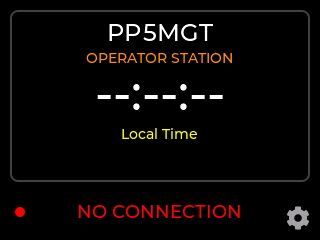<br>Clock | 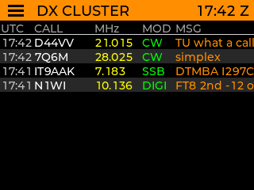<br>DX Cluster | 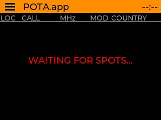<br>POTA |
| 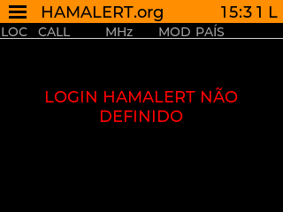<br>HamAlert | 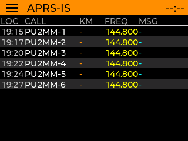<br>APRS list | 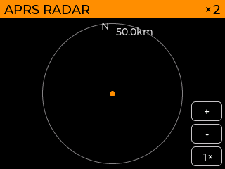<br>APRS radar |
| 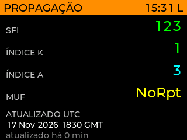<br>Propagation | 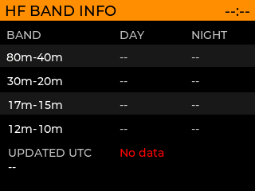<br>HF bands | 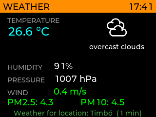<br>Weather |
| 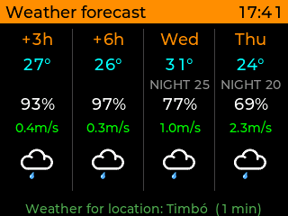<br>Forecast | 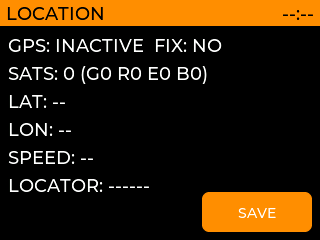<br>Location | 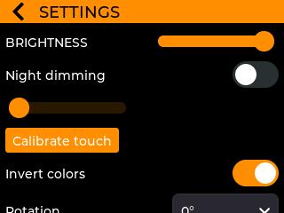<br>Settings |

### Boot screen

While the board starts, the splash screen shows a live log of each boot step
(display, touch, WiFi, time sync and the first data fetches). The WiFi network
name is shown in the log; the password is never logged.

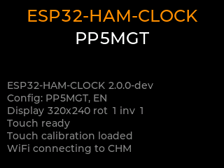<br>
Boot log on the splash screen while the WiFi connection starts.

### Menus

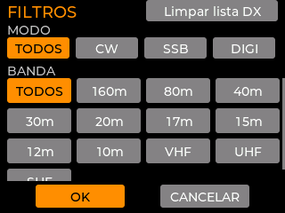 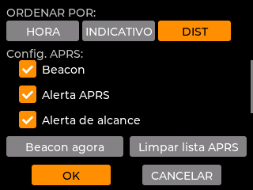<br>
DX Cluster menu (mode and band filters, Clear DX list) and APRS list menu
(sort order, APRS settings, Beacon now, Clear APRS list), in Portuguese.

### Web configuration page

The configuration page served by the board, rendered with the settings the
board reports at `/api/config`. Passwords and API keys are never sent by the
API, so the page shows them only as "(set)". The latitude and longitude fields
are left blank in the images. The WiFi and Station sections are expanded; the
other sections are collapsed. The Export backup warning appears in the header
after pressing **Export backup**.

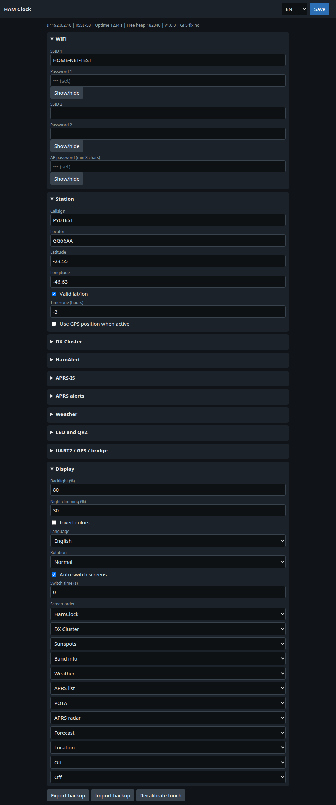<br>
Desktop view (about 1000 px wide), English, after pressing Export backup.

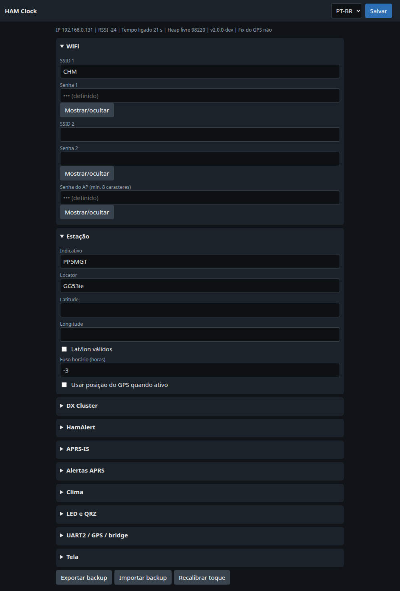<br>
Desktop view, PT-BR language selected in the header.

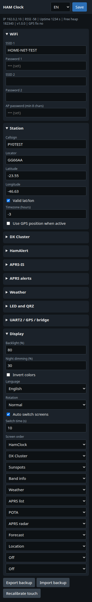<br>
Phone view (360 px wide), English. The layout stacks into one column.

## Hardware

Two board targets are supported:

- `cyd`: ESP32-2432S028R ("Cheap Yellow Display"), single USB. This is the default environment.
- `esp32-38pin`: ESP32 38-pin DevKit with an external ILI9341 display and touch panel.

Pin assignments:

| Function          | `cyd`                | `esp32-38pin`        |
|-------------------|----------------------|----------------------|
| TFT MISO          | 12 (HSPI)            | 12 (HSPI)            |
| TFT MOSI          | 13 (HSPI)            | 13 (HSPI)            |
| TFT SCLK          | 14 (HSPI)            | 14 (HSPI)            |
| TFT CS            | 15                   | 15                   |
| TFT DC            | 2                    | 2                    |
| TFT RST           | -1 (not connected)   | -1 (not connected)   |
| Backlight (PWM)   | 21 (active HIGH)     | 21 (active HIGH)     |
| Touch CLK (VSPI)  | 25                   | 25                   |
| Touch MOSI        | 32                   | 32                   |
| Touch MISO        | 39                   | 27                   |
| Touch CS          | 33                   | 33                   |
| Touch IRQ         | 36                   | 35                   |
| RGB LED red       | 4 (active LOW)       | none                 |
| RGB LED green     | 16 (active LOW)      | none                 |
| RGB LED blue      | 17 (active LOW)      | none                 |
| UART2 RX          | 27                   | 16                   |
| UART2 TX          | 22                   | 17                   |

The `esp32-38pin` build has no RGB LED (`HAS_RGB_LED` is not defined).

## Requirements

Either of the following:

- VS Code with the PlatformIO IDE extension, or
- PlatformIO Core: `pip install platformio`

## Build

The default environment is `cyd`, so plain `pio run` and `pio run -t upload`
target the CYD board.

```sh
pio run -e cyd              # CYD (same as: pio run)
pio run -e esp32-38pin      # ESP32 38-pin DevKit
```

Tests run on the host, without hardware:

```sh
pio test -e native
```

## Flashing over USB

The first time this project is flashed onto a board, erase the flash first.
This clears NVS and anything left by other projects, so it also removes saved
WiFi settings and touch calibration:

```sh
pio run -e cyd -t erase && pio run -e cyd -t upload
```

After that, normal uploads keep the saved settings:

```sh
pio run -e cyd -t upload
```

Serial monitor (115200 baud):

```sh
pio device monitor -b 115200
```

## Flashing from the browser

Open https://mrgadotti.github.io/esp32-ham-clock-lvgl/ in Chrome or Edge,
connect the board over USB, and choose the firmware. The web flasher offers
to erase the flash on a new install.

## First run

If no WiFi network is configured, or the configured network is not found, the
board starts its own access point:

- SSID: `ESP32-HAM-CLOCK`
- Password: `1234567890`
- Configuration page: http://192.168.4.1

Connect to the access point, open the configuration page, and enter your WiFi
network and station settings.

Touch calibration is stored on the device. To force calibration, hold the
screen while the board boots, then follow the on-screen prompts. You can also
hold a finger on the Clock screen for 15 s without moving it (a progress line
appears at the bottom after 5 s) to open the calibration.

## Configuration

Settings are split between two places:

- **TFT Settings screen** (on the device): options that are changed at the
  board, such as display rotation, color inversion, language, screen order,
  enabled screens and the APRS list sort order. Touch calibration is also
  started from here.
- **Web configuration page** (the device's IP address on your LAN, or
  http://192.168.4.1 in access point mode): WiFi, station location and the
  service settings. Secrets such as passwords are never shown; the page only
  reports whether each one is set. Saving the page changes only the fields
  you submit. **Export backup** (`GET /api/backup`) is the exception: the
  downloaded JSON contains every password and API key in plain text, so store
  it safely. Import restores them on a new clock (then press Save). Like the
  rest of the web page, `/api/backup` has no authentication: anyone on the
  LAN (or connected to the AP) can download it.
  The HTTP routes and the full settings reference are in [docs/api.md](docs/api.md).

For development, copy `include/secrets.h.example` to `include/secrets.h` and
set a default WiFi network there. This file is git-ignored and optional. The
build works without it.

## Color inversion

The build uses the ILI9341 driver with inversion on, which matches the CYD
panel. If colors look inverted on your panel, turn inversion off in Settings.
The setting is kept across reboots.

Display rotation can be set to 0 degrees or 180 degrees in Settings. Touch
coordinates follow the rotation.

## Credits

ESP32-HAM-CLOCK-LVGL is derived from ESP32-HAM-CLOCK by Konrad Wisniewski
SP3KON, released under the MIT License. The original work is credited in
[NOTICE](NOTICE), which also reproduces the original MIT text and lists the
third-party components used here:

- LVGL (MIT)
- TFT_eSPI (FreeBSD)
- XPT2046_Touchscreen (MIT)
- ArduinoJson (MIT)
- Montserrat font (SIL Open Font License 1.1)

## License

This project is licensed under the GNU General Public License v3.0. See
[LICENSE](LICENSE). Third-party licenses and the original MIT notice are in
[NOTICE](NOTICE).
